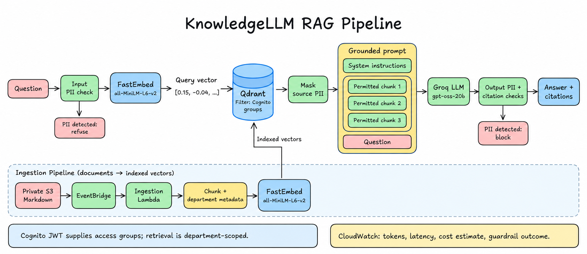

# KnowledgeLLM

🔐 KnowledgeLLM is a permission-aware knowledge assistant prototype. Cognito manages username/password sign-in; a Python API applies Cognito group access before listing S3 documents or retrieving Qdrant chunks. Answers cite only approved, retrieved documents. The included content is fictional.

## RAG pipeline



1. **Authorize:** Cognito signs in the user; API Gateway validates the JWT. The backend derives Finance, Operations, or People access from verified group claims.
2. **Retrieve:** reject questions containing recognized PII patterns, embed the question with FastEmbed (`all-MiniLM-L6-v2`), and search Qdrant with department filters. The backend also checks retrieved document IDs against its approved catalog.
3. **Generate:** mask recognized PII in retrieved text; send system instructions, permitted excerpts, and the question to Groq (`gpt-oss-20b`).
4. **Return:** block PII in output and accept only citations to approved retrieved sources. Unsupported questions return a no-information response; provider failures return a service error.
5. **Observe:** return the guardrail outcome and model usage to the UI, and log metadata to CloudWatch without question, answer, or source text. The displayed dollar value is a token-based estimate, not an invoice or the total AWS bill.

Ingestion runs separately when approved Markdown files are created in S3. It chunks text, attaches department/source metadata, embeds it, and replaces that document's vectors in Qdrant. Query-time embedding and document embedding use the same model. The three chunks in the illustration are examples; retrieval requests up to five matches.

## Deployment architecture

The AWS backend is deployed in Singapore (`ap-southeast-1`) and managed by Terraform. The current demo uses a local React/Vite frontend; Cloudflare Pages and a custom domain are the planned public frontend deployment.

```text
┌───────────────────────────────┐     ┌──────────────────────────────┐
│ React/Vite browser            │  ⇄  │ Cognito user pool            │
│ Local now · Pages planned     │     │ Sign-in + department groups  │
└───────────────────────────────┘     └──────────────────────────────┘
                │ Question + Cognito access token
                ▼
┌──────────────────────────────────────────────────────────────────┐
│ API Gateway HTTP API · validate JWT                              │
│ Knowledge Lambda · derive access from cognito:groups             │
│                                                                  │
│ Input PII check → FastEmbed query vector                         │
│                          ↓                                       │
│ Qdrant search · department filter → permitted chunks             │
│                          ↓                                       │
│ Mask source PII → system instructions + chunks + question        │
│                          ↓                                       │
│ Groq LLM → output PII check + validate citations → answer        │
└──────────────────────────────────────────────────────────────────┘
        │ Provider credentials          │ Safe telemetry
        ▼                               ▼
┌─────────────────────────────┐  ┌─────────────────────────────────┐
│ SSM Parameter Store         │  │ CloudWatch Logs                 │
│ SecureString · backend only │  │ Tokens · latency · guardrails   │
└─────────────────────────────┘  │ Model cost estimate · 7 days    │
                                 └─────────────────────────────────┘

┌──────────────────────────────────────────────────────────────────┐
│ Private S3 Markdown → EventBridge → ingestion Lambda             │
│ Chunk text + department metadata → FastEmbed → Qdrant vectors    │
│ Both Lambdas use /tmp for FastEmbed/Hugging Face caches.         │
│ Authorized source links use short-lived S3 presigned URLs.       │
└──────────────────────────────────────────────────────────────────┘
```

Pages serves static assets without a Docker container. Keep provider keys in the backend secret store; all `VITE_*` configuration is visible in the browser bundle. Cloudflare's static asset requests are free and unlimited, subject to other platform limits; AWS and external providers have separate charges. See [Pages pricing](https://developers.cloudflare.com/pages/functions/pricing/) and [Cloudflare setup](#cloudflare-pages-setup).

## Local development

Vite sends development API requests through its same-origin `/api` proxy, forwarding the bearer token to `VITE_API_URL` (or the configured demo API). This lets both `localhost` and `127.0.0.1` previews load permitted documents without changing AWS CORS. Production builds call the configured API directly and still require the deployed frontend origin in API Gateway CORS.

Requirements: Node.js 20.19+ or 22.12+, npm, Python 3.12, and Git. Install the web app and run the local checks:

```sh
cd web
npm install
npm run dev
npm test
npm run build
npm run format:check
```

To test the API, install its package in a Python 3.12 virtual environment and run pytest:

```sh
cd api
python3.12 -m venv .venv
source .venv/bin/activate
python -m pip install -e '.[dev]'
python -m pytest
```

The frontend supports public Cognito configuration from environment variables; the current demo also includes deployed public endpoint defaults. Copy `web/.env.example` to `web/.env.local` and set `VITE_API_URL`, `VITE_COGNITO_DOMAIN`, `VITE_COGNITO_ISSUER`, `VITE_COGNITO_CLIENT_ID`, and `VITE_REDIRECT_URI` from the deployed stack outputs. The current demo persona buttons sign in through Cognito password authentication and clear the previous workspace when switching. Managed login with authorization code and PKCE is also supported. Demo account credentials shipped in browser code are visible to users; use interactive sign-in for a production deployment. Provider API keys belong only in the backend.

## AWS prototype setup with Terraform

Both Lambda functions configure `FASTEMBED_CACHE_PATH=/tmp/fastembed`, `HF_HOME=/tmp/huggingface`, and `HF_HUB_CACHE=/tmp/huggingface/hub`. FastEmbed also receives an explicit writable cache directory in code. This avoids model downloads writing to Lambda's read-only filesystem; caches are temporary per execution environment. Rebuild the Lambda package and apply the reviewed Terraform change before checking ingestion again. See [AWS ephemeral storage documentation](https://docs.aws.amazon.com/lambda/latest/dg/configuration-ephemeral-storage.html).

☁️ Terraform in `infra/terraform/` creates Cognito managed login, the three department groups, private encrypted/versioned document storage, a JWT-protected HTTP API, Lambda functions, and S3-triggered ingestion. The Cognito app client has no client secret and supports the demo password flow and authorization code with PKCE. API Gateway validates JWTs; protected routes leave required OAuth scopes unset so Cognito password-flow access tokens can be used. Self-registration is disabled; create users administratively and add each user to exactly one of `finance`, `operations`, or `people`.

Create Qdrant and Groq credentials outside the repository. The deployed Terraform stack stores them in standard SSM Parameter Store `SecureString` parameters. Supply values through ignored configuration or an approved deployment environment; never put keys in frontend variables. Existing secret identifiers can also be supplied through the configuration variables. To use a secure remote S3 backend for Terraform state in Singapore (`ap-southeast-1`), run the one-time bootstrap setup first:

```sh
rtk terraform -chdir=infra/bootstrap init
rtk terraform -chdir=infra/bootstrap apply
```

Then build the Lambda package, copy the configuration, and provision the main infrastructure:

```sh
rtk bash scripts/package-lambdas.sh
rtk cp infra/terraform/terraform.tfvars.example infra/terraform/terraform.tfvars
rtk terraform -chdir=infra/terraform init
rtk terraform -chdir=infra/terraform validate
rtk terraform -chdir=infra/terraform plan
rtk terraform -chdir=infra/terraform apply
```

Set `cognito_domain_prefix` to a globally unique lowercase value and set the web origin, callback, and logout URLs to your exact frontend URLs. Configure the frontend from Terraform outputs (`api_url`, `cognito_issuer`, `cognito_client_id`, and `cognito_domain_url`). The package script needs Python 3.12 and pip. Its Lambda requirements omit `boto3` because the Python 3.12 Lambda runtime includes the AWS SDK; the script checks the 250 MiB uncompressed deployment limit. [AWS Python runtime docs](https://docs.aws.amazon.com/lambda/latest/dg/lambda-python.html) · [Lambda quotas](https://docs.aws.amazon.com/lambda/latest/dg/gettingstarted-limits.html). Terraform state contains infrastructure metadata; keep it private and use a secured remote backend for shared environments.

```sh
rtk terraform -chdir=infra/terraform output
```

After deployment, upload only the fictional samples to the `documents_bucket_name` output, preserving department folders. S3 sends object-created events through EventBridge to the ingestion Lambda. Ingestion creates Qdrant keyword indexes for `department` and `document_id` before replacing filtered records. The API uses FastEmbed on CPU, Qdrant department filters, and Groq JSON answers with server-validated citation IDs. Set both `groq_input_rate_per_million_usd` and `groq_output_rate_per_million_usd` from current pricing to show cost estimates; otherwise cost is reported as unavailable. Terraform resources and provider usage can still incur charges, including S3 storage, Lambda, API Gateway, Cognito usage, and external providers. `terraform destroy` removes the managed AWS resources; versioned bucket objects must be removed before destroy.

Track deployment and demo progress in the [implementation plan](docs/superpowers/plans/2026-10-06-knowledgellm-full-stack-prototype.md#deployment-and-demo-checklist). The Terraform-managed private Lambda artifact bucket is temporary deployment storage and is force-removed during `terraform destroy`; keep its contents limited to the built code package.

Before provisioning, review account-specific allowances and current provider terms: [Cognito](https://aws.amazon.com/cognito/pricing/), [Lambda](https://aws.amazon.com/lambda/pricing/), [API Gateway](https://aws.amazon.com/api-gateway/pricing/), [S3](https://aws.amazon.com/s3/faqs/), [Systems Manager](https://aws.amazon.com/systems-manager/pricing/), [Qdrant](https://qdrant.tech/pricing/), [Groq rate limits](https://console.groq.com/docs/rate-limits), and [Groq data handling](https://console.groq.com/docs/your-data). Check CloudWatch pricing in the observability section below.

## Cloudflare Pages setup

Cloudflare is configured separately from the AWS Terraform stack. Check [Pages limits](https://developers.cloudflare.com/pages/platform/limits/) before deployment; domain registration and backend services have separate costs.

1. In Cloudflare Workers & Pages, create a Pages project connected to this GitHub repository. Select the approved frontend branch; use `main` for production after the implementation is merged.
2. Set root directory to `web`, build command to `npm run build`, output directory to `dist`, and Node.js to a supported version (22.12+). See the [Vite guide](https://developers.cloudflare.com/pages/framework-guides/deploy-a-vite3-project/).
3. Choose a stable origin such as `https://knowledgellm.pages.dev` or `https://knowledge.example.com`. Set Terraform `web_origin` to that origin, and `web_callback_url` and `web_logout_url` to the same URL with a trailing `/`. Review and apply the Terraform plan.
4. Set Pages production build variables from Terraform outputs:

   | Pages variable | Terraform output or value |
   | --- | --- |
   | `VITE_API_URL` | `api_url` |
   | `VITE_COGNITO_DOMAIN` | `cognito_domain_url` |
   | `VITE_COGNITO_ISSUER` | `cognito_issuer` |
   | `VITE_COGNITO_CLIENT_ID` | `cognito_client_id` |
   | `VITE_REDIRECT_URI` | Exact `web_callback_url` |

5. Deploy or rebuild after setting variables. Check HTTPS sign-in, logout, account switching, source links, chat, and page refresh on the stable URL. Provider keys stay in the AWS backend secret store; GitHub Secrets or Pages build settings do not automatically configure Lambda.
6. For a custom domain, add it under the Pages project's Custom domains settings and complete the [required DNS setup](https://developers.cloudflare.com/pages/configuration/custom-domains/). When changing domains, update Terraform CORS/callback/logout URLs and the Pages redirect variable, rebuild, and repeat login checks. Preview URLs need separately allowed URLs; the current stack accepts one configured origin/callback/logout URL.

## Chat observability

The PII monitor shows the last backend outcome: **No PII detected**, **Question PII blocked**, **Answer PII blocked**, or **Source PII masked**. It distinguishes pending checks, failed requests, and missing results. These are basic pattern checks, not comprehensive personal-data detection. Five department-specific question buttons fill the composer without submitting.

📊 Chat telemetry is written as structured metadata to the Terraform output `knowledge_log_group_name`: token counts, estimated model cost, latency, department, retrieved count, and guardrail outcome. It does not log questions, answers, or source text. Terraform sets log retention to seven days and creates no custom metrics or paid dashboards. AWS currently includes 5 GB/month for CloudWatch Logs ingestion, archive storage, and Logs Insights scan data, but this allowance is shared across the account and is not a guarantee of a $0 bill. Review current regional pricing and set AWS billing alerts before deployment. [CloudWatch pricing](https://aws.amazon.com/cloudwatch/pricing/).

In CloudWatch Logs Insights, select that log group to summarize guardrail outcomes:

```text
fields @timestamp, @message
| filter @message like /chat_telemetry/
| parse @message /"guardrail_action":"(?<action>[^"]+)"/
| stats count() by action
```

To review token use by hour:

```text
fields @timestamp, @message
| filter @message like /chat_telemetry/
| parse @message /"input_tokens":(?<input_tokens>\d+)/
| parse @message /"output_tokens":(?<output_tokens>\d+)/
| stats sum(input_tokens) as input_tokens, sum(output_tokens) as output_tokens by bin(1h)
```

## Access and prototype limits

API Gateway validates JWTs. The API derives access only from the verified `cognito:groups` claim; request department values are ignored. S3 stays private, source links expire after 120 seconds, and unknown or cross-department document IDs return the same not-found response. Ingestion accepts only catalogued Markdown keys up to 1 MB. Document IDs are opaque single path segments; S3 keys remain department-prefixed.

The PII guardrail currently detects and redacts common email, phone, and U.S. SSN patterns. This is a prototype filter, not comprehensive PII detection or a compliance control. Keep real company data out of the sample until provider handling, deployment region, retention, and organizational approval have been reviewed. Provider errors do not return prompts or source excerpts. See [the product spec](docs/superpowers/specs/2026-10-06-knowledgellm-design.md) for architecture, failure behavior, and cost assumptions.

## Cleanup

Remove the Pages project and its associated custom-domain DNS records if the public demo is no longer needed. Empty all object versions and delete markers in the private document bucket before destroying the AWS resources:

```sh
rtk terraform -chdir=infra/terraform destroy
```

Confirm the managed resources are gone. Secrets created outside Terraform, external Qdrant clusters, and Groq/Qdrant credentials require separate cleanup. Preserve any resources still used by another environment.
