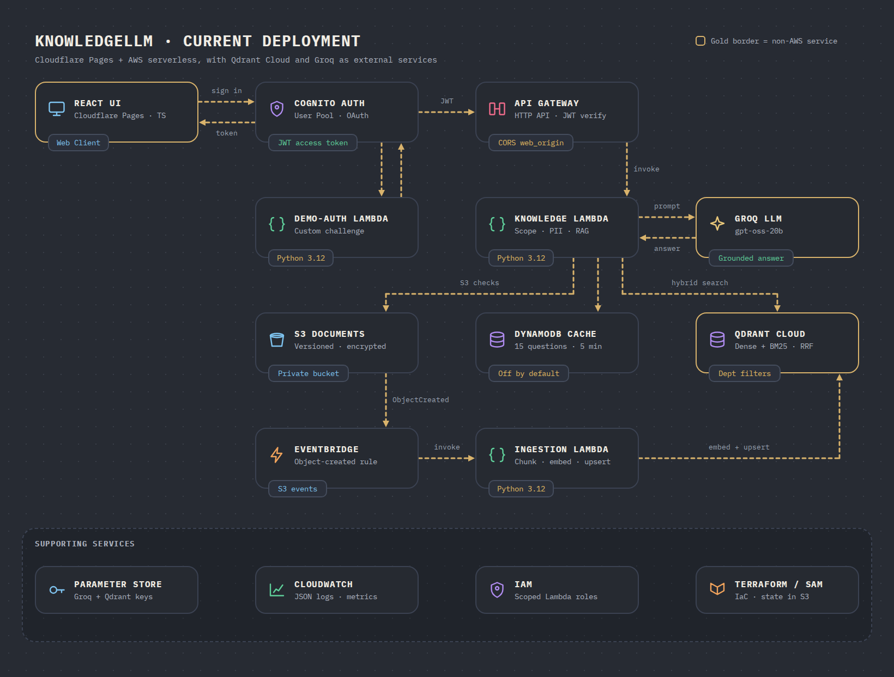
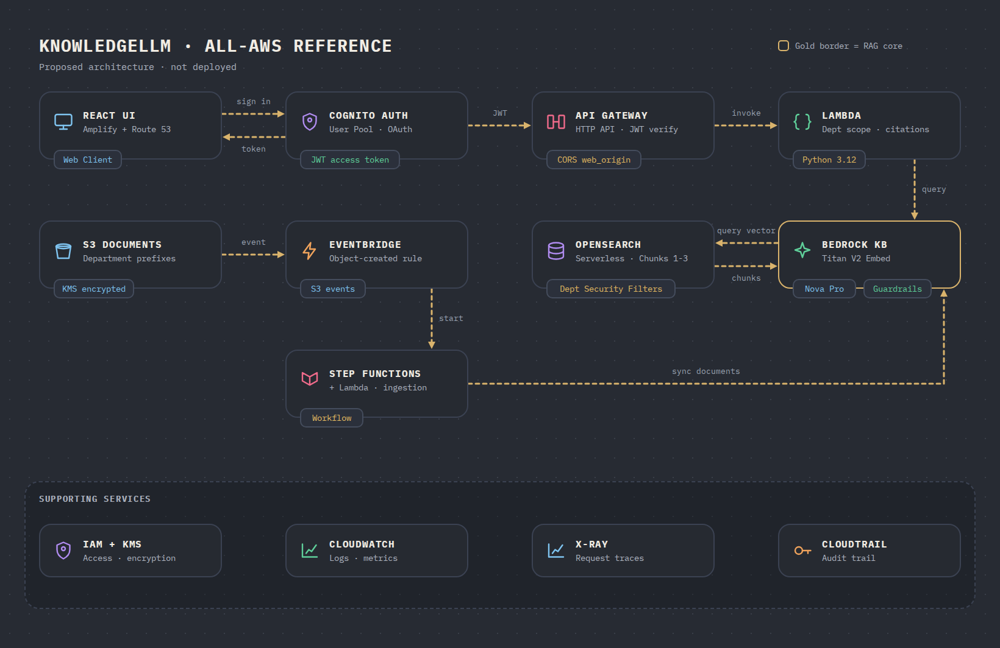

# KnowledgeLLM

Permission-aware RAG demo for Finance, Operations, and People, with grounded citations and optional answer caching.

## Tech Stack

**Frontend:** React 19 · TypeScript · Vite · Lucide React · IBM Plex · Vitest · Testing Library

**Backend:** Python 3.12 · boto3 · Qdrant Cloud Inference (multilingual embeddings) · Qdrant Cloud · Groq (`openai/gpt-oss-20b`) · pytest

The demo indexes English and Traditional Chinese Markdown in `knowledgellm-qdrant-hybrid-e5-small`: 384-dimensional `intfloat/multilingual-e5-small` dense vectors plus server-side `Qdrant/bm25` sparse vectors, fused with RRF. The former dense-only collection remains available for rollback; vectors are never mixed across collection schemas.

**Infra:** Cloudflare Pages (web hosting, deployed by GitHub Actions) · Cognito · API Gateway · Lambda · S3 · EventBridge · DynamoDB · Parameter Store · IAM · CloudWatch · Terraform · AWS SAM

## Hybrid Workflow



Cache: exactly 15 suggested questions, five-minute logical TTL, disabled by default. Custom questions bypass caching; source-version and hybrid-retrieval changes invalidate earlier entries.

## All-AWS Reference

Proposed architecture · not deployed.

**Frontend:** React · TypeScript · Vite

**Backend:** Python 3.12 Lambda · Bedrock Knowledge Bases · Titan Embeddings V2 · Nova Pro · Bedrock Guardrails · OpenSearch Serverless

**Infra:** Route 53 · Amplify Hosting · Cognito · API Gateway · S3 · EventBridge · Step Functions · IAM · KMS · CloudWatch · X-Ray · CloudTrail



## Security & Telemetry

Cognito groups enforce department access; the backend checks citations, blocks common PII patterns, and masks source PII. CloudWatch records latency, token counts, cache status, and guardrail outcomes without raw content or authentication tokens.

## Quickstart

Requires Node.js 20.19+ or 22.12+, Python 3.12, and configured AWS credentials.

### 1 · Web App

From `web/`, configure `.env.local` with public API/Cognito values.

```sh
rtk proxy cp .env.example .env.local
rtk npm ci
rtk npm run dev      # http://localhost:5173
rtk npm test
rtk npm run build
```

Optional public preview with [cloudflared](https://developers.cloudflare.com/tunnel/get-started/quick-tunnels/): keep Vite running and use a second terminal.

```sh
rtk proxy cloudflared tunnel --url http://localhost:5173 --http-host-header localhost:5173
```

Open the printed HTTPS URL; Ctrl+C stops the tunnel. For API calls, add that URL's origin to API Gateway CORS (`web_origin`).

### 2 · Backend API

From `api/`:

```sh
rtk proxy python3.12 -m venv .venv
rtk proxy .venv/bin/python -m pip install -e '.[dev]'
rtk proxy .venv/bin/python -m pytest
```

### 3 · Deploy Infrastructure (Terraform)

From the repository root, create the S3 state bucket once with `infra/bootstrap` (its name must match the `backend "s3"` block in `infra/terraform/versions.tf`), then configure `terraform.tfvars` and the Groq and Qdrant secrets before deployment. Rebuild the Lambda packages from the current checkout before every plan. An existing ZIP can contain code from another branch; deploying it can mismatch the embedding model and index manifests and make ordinary chat requests fail while PII refusals still work.

```sh
rtk proxy bash scripts/package-lambdas.sh
rtk proxy cp infra/terraform/terraform.tfvars.example infra/terraform/terraform.tfvars
# Fill in terraform.tfvars before initialization and review the plan.
rtk proxy terraform -chdir=infra/terraform init
rtk proxy terraform -chdir=infra/terraform plan -out=tfplan
rtk proxy terraform -chdir=infra/terraform apply tfplan
```

`template.yaml` is an equivalent AWS SAM definition of the same API; Terraform is the path documented here.

### 4 · Deploy the Web App

Pushes to `main` run `.github/workflows/deploy-pages.yml`, which tests, builds, and publishes `web/dist` to the Cloudflare Pages project `knowledgellm`. Set these repository secrets first: `CLOUDFLARE_API_TOKEN`, `CLOUDFLARE_ACCOUNT_ID`, `VITE_API_URL`, `VITE_COGNITO_DOMAIN`, `VITE_COGNITO_ISSUER`, `VITE_COGNITO_CLIENT_ID`, and `VITE_REDIRECT_URI`. Add the site's origin to `web_origin` so API Gateway CORS allows it.

## License

Fictional educational prototype for portfolio and technical demonstration purposes.
