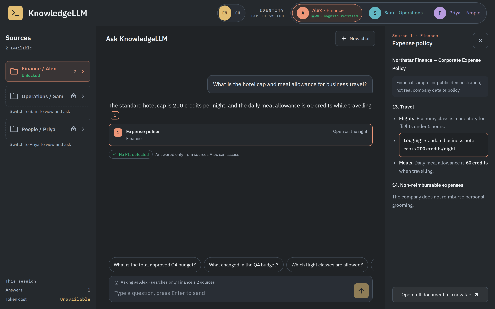
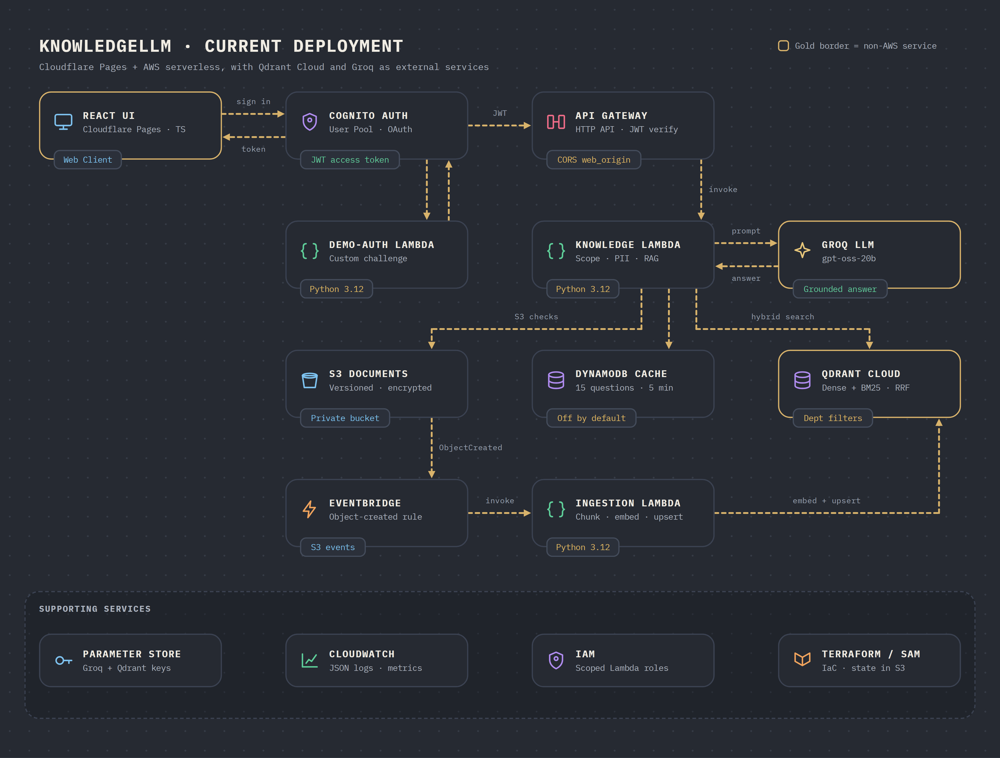
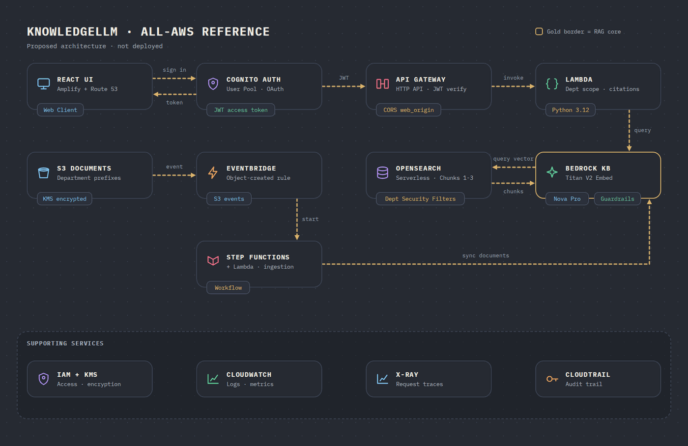
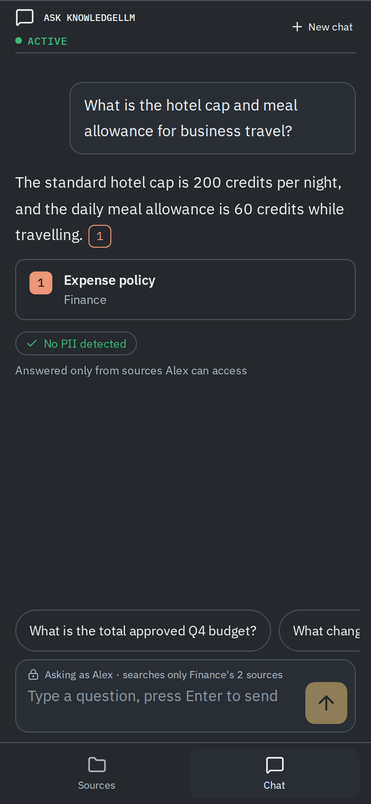

<div align="center">

# KnowledgeLLM

**Permission-aware RAG for company documents.**
Ask in English or 繁體中文 and get cited answers drawn only from the sources you are allowed to see.




<sub>Fictional demo data. The answer shown is a mocked response used for this screenshot.</sub>

</div>

## Highlights

| | |
|---|---|
| 🔐 **Department access control** | Cognito groups scope every request to Finance, Operations, or People. A user can never retrieve another department's sources. |
| 🔎 **Hybrid retrieval** | Dense multilingual vectors plus BM25, fused with RRF in Qdrant Cloud, filtered by department and document version. |
| 📎 **Grounded citations** | Every answer links to its sources, opens them in a side reader, and highlights the matching passage. |
| 🛡️ **Guardrails** | PII is blocked on input, masked in sources, and citations are validated before an answer is returned. |
| 🌏 **Bilingual** | English and Traditional Chinese documents, questions, and UI. |
| ⚡ **Answer cache** | Fixed demo questions are cached in DynamoDB with a five-minute TTL. Custom questions always bypass it. |

## Architecture

### Current deployment



1. **Sign in:** the React app on Cloudflare Pages authenticates through Cognito and receives a JWT.
2. **Ask:** API Gateway verifies the JWT and invokes the Knowledge Lambda. It checks department scope and PII, then tries the DynamoDB cache. On a miss it runs hybrid search in Qdrant Cloud and asks Groq for a grounded answer.
3. **Ingest:** an S3 upload triggers EventBridge and the Ingestion Lambda, which chunks, embeds, and upserts the document into Qdrant.

### All-AWS reference (proposed, not deployed)



The same flow on managed AWS services only: Bedrock Knowledge Bases with Titan V2, Nova Pro, and Guardrails over OpenSearch Serverless, with Step Functions orchestrating ingestion.

## Tech Stack

| Layer | Technologies |
|---|---|
| **Frontend** | React 19 · TypeScript · Vite · Lucide · IBM Plex · Vitest · Testing Library · Playwright |
| **Backend** | Python 3.12 · AWS Lambda · boto3 · pytest |
| **AI and search** | Groq (`openai/gpt-oss-20b`) · Qdrant Cloud Inference (`intfloat/multilingual-e5-small`, 384-dim, plus `Qdrant/bm25`) |
| **Cloud** | Cloudflare Pages · Cognito · API Gateway · S3 · EventBridge · DynamoDB · Parameter Store · IAM · CloudWatch |
| **Delivery** | Terraform · AWS SAM · GitHub Actions · Gitleaks |

## Demo Personas

Three fictional users sign in through Cognito, and each sees only their own department.

| Persona | Department | Can search |
|---|---|---|
| Alex | Finance | Expense policy, Q4 budget |
| Sam | Operations | Runbook procedures, service handoff |
| Priya | People | Employee handbook, leave policy |

## Run Locally

Requires Node.js 20.19+ (or 22.12+) and Python 3.12.

```sh
# Web app, from web/
cp .env.example .env.local   # add the public API and Cognito values
npm ci && npm run dev        # http://localhost:5173

# Tests
npm test && npm run build    # from web/
python3.12 -m venv .venv && .venv/bin/pip install -e '.[dev]' && .venv/bin/pytest   # from api/
```

Browser regression tests live in `web/tests/e2e`; see [`web/tests/README.md`](web/tests/README.md).

## Deployment

**Infrastructure (Terraform).** Create the S3 state bucket once with `infra/bootstrap`; its name must match the backend block in `infra/terraform/versions.tf`. Then fill in `terraform.tfvars` and rebuild the Lambda packages before every plan, because a stale ZIP can mismatch the embedding model and index manifests.

```sh
bash scripts/package-lambdas.sh
cp infra/terraform/terraform.tfvars.example infra/terraform/terraform.tfvars
terraform -chdir=infra/terraform init
terraform -chdir=infra/terraform plan -out=tfplan
terraform -chdir=infra/terraform apply tfplan
```

`template.yaml` is an equivalent AWS SAM definition of the same API.

**Web app (Cloudflare Pages).** Pushes to `main` run `.github/workflows/deploy-pages.yml`, which tests, builds, and publishes `web/dist`. Set these repository secrets first: `CLOUDFLARE_API_TOKEN`, `CLOUDFLARE_ACCOUNT_ID`, `VITE_API_URL`, `VITE_COGNITO_DOMAIN`, `VITE_COGNITO_ISSUER`, `VITE_COGNITO_CLIENT_ID`, and `VITE_REDIRECT_URI`. Add the site origin to `web_origin` so API Gateway CORS allows it.

**Secret scanning (Gitleaks).** `.github/workflows/gitleaks.yml` scans the full git history on every push and pull request to `main` and fails the check if a credential is found. It needs no secrets of its own.

## Security and Telemetry

- Cognito groups enforce department access on the server, not in the UI.
- Groq and Qdrant keys live in Parameter Store, never in the repository, and Gitleaks guards against accidental commits.
- CloudWatch records latency, token counts, cache status, and guardrail outcomes. It never stores raw content or authentication tokens.

<div align="center">


<sub>Responsive down to 320px.</sub>
</div>

## License

Fictional educational prototype for portfolio and technical demonstration purposes.
