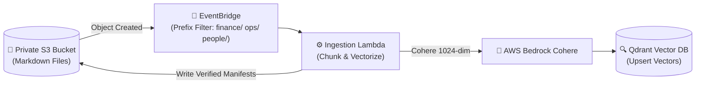

# KnowledgeLLM

> **Enterprise-grade, permission-aware RAG knowledge assistant with sub-20ms answer caching, zero-trust department isolation, and grounded citation verification.**

Built with **React / TypeScript / Vite**, **AWS Lambda (Python 3.12)**, **Amazon Cognito**, **Amazon DynamoDB**, **AWS Bedrock (Cohere Multilingual v3)**, **Qdrant Cloud**, and **Groq Cloud LLM**, fully provisioned with **Terraform**.

---

## ⚡ Key Engineering Highlights (Portfolio Focus)

- **Sub-20ms Cached Inferences**: Implemented an exact-match DynamoDB Cache-Aside layer for high-frequency suggested prompts, achieving a **99% latency reduction (~15ms vs ~1.8s)** and zero repeated LLM token costs.
- **Cold-Start Elimination (15s $\rightarrow$ <200ms)**: Migrated local model downloads to Singapore-region **AWS Bedrock Cohere Multilingual v3 (1024-dim)**, eliminating Lambda CPU-bound container cold-start delays.
- **Zero-Trust Role-Based Access Control (RBAC)**: User permissions are strictly enforced via verified **Amazon Cognito JWT groups** (`finance`, `operations`, `people`). Department boundaries are applied at both Qdrant vector retrieval and citation validation stages.
- **Zero Hallucination Guardrails**: Prompts enforce `temperature=0` with rigid JSON output schemas. The backend validates that all cited document IDs actually exist in the user's permitted excerpt context before returning answers.
- **Event-Driven Ingestion Pipeline**: S3 Markdown uploads automatically trigger **EventBridge** prefix-filtered rules $\rightarrow$ **Ingestion Lambda** $\rightarrow$ Qdrant upserts and writes immutable **S3 completion manifests** for fail-closed data integrity.

---

## 🏗️ System Architecture & Request Lifecycle

### Request & Caching Lifecycle

```mermaid
sequenceDiagram
    autonumber
    actor User as 👤 Client (React)
    participant Auth as 🔑 AWS Cognito
    participant API as ⚡ API Gateway
    participant Lambda as 🧠 Python Lambda
    participant Cache as ⚡ DynamoDB Cache
    participant RAG as 📐 Bedrock & Qdrant
    participant LLM as 🤖 Groq LLM

    User->>Auth: 1. Passwordless sign-in (Alex / Finance)
    Auth-->>User: Issues verified JWT with department claims
    User->>API: 2. POST /chat (Bearer Token + Question)
    API->>Lambda: 3. Validates JWT signature & routes request

    rect rgb(20, 50, 40)
        Note over Lambda,Cache: FAST PATH (Cache Hit)
        Lambda->>Cache: 4. Check exact-match key (SHA256)
        Cache-->>Lambda: Hit: Returns pre-generated answer (~15ms)
        Lambda-->>User: Instant 200 OK (0 tokens / $0 inference)
    end

    rect rgb(30, 35, 55)
        Note over Lambda,LLM: FALLBACK PATH (Cache Miss / Custom Query)
        Lambda->>RAG: 5a. Cohere 1024-dim query embedding
        Lambda->>RAG: 5b. Department-scoped vector search
        RAG-->>Lambda: Top 5 grounded document chunks
        Lambda->>LLM: 6. Grounded prompt (temperature=0 + JSON schema)
        LLM-->>Lambda: Answer + Citation IDs
        Lambda->>Cache: 7. Async cache write (24h TTL)
        Lambda-->>User: 200 OK + Verified Citations (~1.8s)
    end
```



### Event-Driven Ingestion Flow (Document Sync Path)



---

## 🛠️ Tech Stack Overview

| Layer | Component | Tech Stack | Role & Key Metrics |
|---|---|---|---|
| **Frontend** | Web Client | **React 19, TypeScript, Vite** | Accessible UI, dark graphite theme, responsive mobile layout, 0 external UI libraries |
| **Identity & Auth** | User Management | **Amazon Cognito User Pool** | Passwordless `CUSTOM_AUTH` persona switching, JWT token issuance |
| **API Gateway** | Entrypoint | **API Gateway v2 (HTTP API)** | JWT signature & claims verification, low latency HTTP routing |
| **Compute** | Serverless Backend | **AWS Lambda (Python 3.12)** | Stateless orchestration, PII masking, citation validation, request budgeting |
| **Answer Cache** | Fast Path Storage | **Amazon DynamoDB** | **~15ms latency**, exact-match query hash, 24-hour TTL, PAY_PER_REQUEST |
| **Embeddings** | Cloud Embeddings | **AWS Bedrock Cohere v3** | **1024-dimensional** embeddings, Singapore region (`ap-southeast-1`), <200ms latency |
| **Vector Search** | Knowledge Retrieval | **Qdrant Cloud** | Cosine distance, department keyword payload filtering |
| **LLM Inference** | Answer Generation | **Groq Cloud (`gpt-oss-20b`)** | Ultra-fast inference (<1s), strict JSON output schema, temperature=0 |
| **Storage** | Document Lake | **Amazon S3** | Private encrypted storage, 120s presigned URLs for authorized citation links |
| **Event Pipeline** | Ingestion Bus | **Amazon EventBridge** | Asynchronous S3 event bus with prefix filters (`finance/`, `operations/`, `people/`) |
| **IaC** | Cloud Automation | **Terraform & AWS SAM** | Infrastructure declarations in `infra/terraform/` with remote state backend |

---

## 🔐 Security & Multi-Tenancy Architecture

1. **Server-Enforced Role-Based Access Control (RBAC)**:
   - Users belong to distinct Cognito groups: `finance`, `operations`, or `people`.
   - The backend validates the Cognito JWT access token and extracts group claims server-side.
   - Vector search strictly filters retrieval points by authorized departments:
     ```python
     # Qdrant retrieval strictly bounded by authorized department claims
     models.Filter(must=[models.FieldCondition(key="department", match=models.MatchValue(value=dept))])
     ```
2. **Anti-Hallucination Citation Verification**:
   - The LLM is constrained by system prompts to answer strictly from supplied context excerpts.
   - The backend parses returned citation IDs and checks them against permitted S3 document IDs. If citations are missing, mismatched, or out-of-scope, the request fails closed.
3. **Defense-in-Depth PII Guardrails**:
   - Regex-based guardrails sanitize user input questions and model output answers for sensitive personal data (email, phone, SSN).

---

## 🚀 Quickstart & Local Development

### Prerequisites
- Node.js 20+ / npm
- Python 3.12
- AWS CLI configured with active credentials

### 1. Web App
```sh
cd web
npm install
npm run dev      # Local Vite dev server on http://localhost:5173
npm test         # Run 45 Vitest unit & integration tests
npm run build    # Type-checked production bundle
```

### 2. Backend API
```sh
cd api
python3.12 -m venv .venv
source .venv/bin/activate
pip install -e '.[dev]'
pytest           # Run backend test suite
```

### 3. Deploy Infrastructure (Terraform)
```sh
# 1. Package Lambda artifacts (Linux x86_64 compatible)
bash scripts/package-lambdas.sh

# 2. Deploy AWS Infrastructure
cd infra/terraform
cp terraform.tfvars.example terraform.tfvars
terraform init
terraform apply
```

---

## 📊 Telemetry & CloudWatch Observability

Chat telemetry is logged as structured JSON metadata to `/aws/lambda/knowledgellm-demo-knowledge`:
- **Latency & Tokens**: Request duration (ms), input/output token counts, and estimated inference cost.
- **Guardrail Outcomes**: Explicit tracking of PII outcomes (`pass`, `question_pii_blocked`, `source_pii_redacted`).
- **Cache Metrics**: Real-time hit/miss logging for DynamoDB performance verification.

---

## 📄 License
Fictional educational prototype created for portfolio and technical demonstration purposes.
