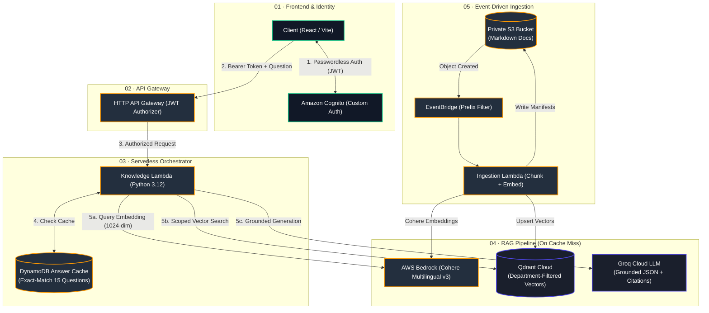
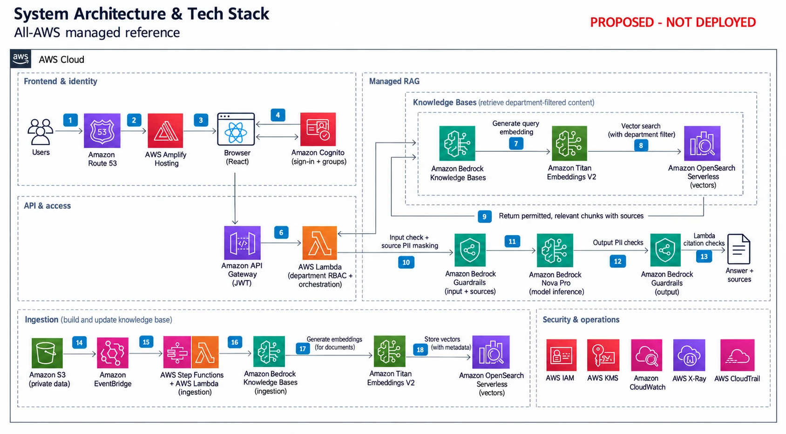

# KnowledgeLLM

🔐 KnowledgeLLM is a permission-aware knowledge assistant prototype. Cognito provides password-free demo sign-in and managed login; a Python API applies Cognito group access before listing S3 documents or retrieving Qdrant chunks. Answers cite only approved, retrieved documents. The included content is fictional.

## System Architecture & Tech Stack

KnowledgeLLM has two architecture options. **Option A is the current cost-conscious demo**; **Option B is an all-AWS managed reference design**, with service choices driven by operational capabilities rather than free allowances. Option B is not deployed and does not replace the current stack.

### Option A — Cost-conscious demo (Deployed Architecture)

The AWS backend is deployed in Singapore (`ap-southeast-1`), engineered for low latency, zero-trust department isolation, and cost efficiency.



```text
┌────────────────────────────────────────────────────────────────────────────────────────┐
│ 01  CLIENT & IDENTITY (Zero-Trust Role-Based Access)                                   │
│                                                                                        │
│ React / Vite UI ⇄ Amazon Cognito (CUSTOM_AUTH passwordless flow)                       │
│ Claims verified: alex (finance) · sam (operations) · priya (people)                    │
└───────────────────────────────────────────┬────────────────────────────────────────────┘
                                            │ JWT Bearer Token
                                            ▼
┌────────────────────────────────────────────────────────────────────────────────────────┐
│ 02  GATEWAY & ORCHESTRATION (AWS Lambda Python 3.12)                                   │
│                                                                                        │
│ API Gateway validates JWT signature → Extracts authorized department claims            │
│ Input Guardrail: Regex PII detection & validation                                      │
└───────────────────────────────────────────┬────────────────────────────────────────────┘
                                            │
                       ┌────────────────────┴────────────────────┐
                       │ Check DynamoDB Answer Cache (15 Prompts)│
                       └────────────────────┬────────────────────┘
                                            │
             ┌──────────────────────────────┴──────────────────────────────┐
             ▼ [Cache HIT: ~15ms]                                          ▼ [Cache MISS / Custom Query]
┌──────────────────────────────────────────┐  ┌──────────────────────────────────────────┐
│ FAST PATH (DynamoDB Cache Hit)           │  │ RAG PIPELINE (Cohere + Qdrant + Groq)     │
│                                          │  │                                          │
│ • Key: SHA256(Department + Normalized Q) │  │ 1. Embed Query: AWS Bedrock Cohere v3    │
│ • Checked 24h TTL                        │  │    (1024-dim, ap-southeast-1, <200ms)    │
│ • Validates citations & output PII       │  │ 2. Vector Retrieval: Qdrant Cloud         │
│ • 0 Groq generation tokens / $0 inference│  │    (Enforces metadata department filter) │
│ • Returns cached answer in ~15ms         │  │ 3. Generation: Groq LLM (gpt-oss-20b)     │
│                                          │  │    (Strict JSON schema + citation links) │
└──────────────────────────────────────────┘  └──────────────────────────────────────────┘
                                            │
                                            ▼
┌────────────────────────────────────────────────────────────────────────────────────────┐
│ 04  EVENT-DRIVEN INGESTION & DATA INTEGRITY                                            │
│                                                                                        │
│ S3 Markdown upload → EventBridge (prefix filtered: finance/, operations/, people/)     │
│   → Ingestion Lambda → Chunks text → Bedrock Cohere Embeddings → Qdrant Vector Upsert  │
│   → Writes immutable verification manifest to S3 (_indexes/knowledgellm-cohere-v3/)   │
└────────────────────────────────────────────────────────────────────────────────────────┘
```

#### Key Architecture Highlights (Portfolio Focus)

- **Eliminated Cold-Start Delays (15s $\rightarrow$ <200ms)**: Migrated local FastEmbed downloads from Hugging Face to Singapore-local **AWS Bedrock Cohere Multilingual v3**, completely removing container initialization latency.
- **Sub-20ms Cached Inferences**: Added a DynamoDB Answer Cache layer for high-frequency suggested questions, reducing response time by 99% and eliminating repetitive LLM inference costs.
- **Zero-Trust Department Isolation**: Access scope is derived strictly from verified Cognito JWT groups. Department filters are applied at both the vector retrieval stage (Qdrant payload filters) and the citation validation stage.
- **Zero Hallucination Guardrails**: Prompts enforce temperature=0 with rigid JSON output schemas. The backend validates that all cited document IDs actually exist in the user's permitted excerpt context before returning answers.
- **Fail-Closed Data Integrity**: S3 completion manifests ensure chat queries only execute against fully-indexed, immutable document versions. If a document is updated before re-indexing completes, the system safely refuses rather than hallucinating outdated context.

### Option B — All-AWS managed reference

**Proposed only.** Host React on Amplify, authenticate with Cognito, and keep orchestration in Lambda. Replace Cohere with Titan Text Embeddings V2, Qdrant with OpenSearch Serverless, and Groq with an Amazon Nova model on Bedrock. Knowledge Bases manages document parsing/chunking and retrieval; Step Functions plus Lambda starts and monitors ingestion jobs. [Amplify hosting](https://aws.amazon.com/amplify/hosting/), [Titan embeddings](https://docs.aws.amazon.com/bedrock/latest/userguide/model-card-amazon-titan-text-embeddings-v2.html).



```text
┌────────────────────────────────────────────────────────────────────────────┐
│ 01  ENTRY · proposed AWS hosting                                           │
│                                                                            │
│ Route 53 → Amplify Hosting (React frontend + managed HTTPS)                │
│ Browser ⇄ Cognito (sign-in + department groups)                            │
└────────────────────────────────────────────────────────────────────────────┘
                         │
                         ▼
┌────────────────────────────────────────────────────────────────────────────┐
│ 02  API & AUTHORIZATION                                                    │
│                                                                            │
│ API Gateway validates JWT → Lambda (RBAC + RAG orchestration)              │
│ Lambda constructs department filters from verified Cognito groups          │
└────────────────────────────────────────────────────────────────────────────┘
                         │
                         ▼
┌────────────────────────────────────────────────────────────────────────────┐
│ 03  MANAGED RAG · all service calls stay on AWS                            │
│                                                                            │
│ Bedrock Guardrails: input check                                            │
│ Knowledge Bases Retrieve → Titan query embedding → OpenSearch              │
│ Department-filtered chunks → explicit ApplyGuardrail source masking        │
│ Grounded prompt → Bedrock Nova Pro → output Guardrails                     │
│ Lambda validates source citations → answer + sources                       │
└────────────────────────────────────────────────────────────────────────────┘

┌────────────────────────────────────────────────────────────────────────────┐
│ 04  INGESTION · proposed AWS orchestration                                 │
│                                                                            │
│ Private S3 files + metadata → EventBridge → Step Functions + Lambda        │
│ Start / monitor Knowledge Bases ingestion → parse + chunk                  │
│ Titan Text Embeddings V2 → OpenSearch Serverless vector index              │
└────────────────────────────────────────────────────────────────────────────┘

┌────────────────────────────────────────────────────────────────────────────┐
│ 05  SECURITY & OPERATIONS                                                  │
│                                                                            │
│ IAM roles + enforced guardrails · KMS encryption                           │
│ CloudWatch metrics / logs · X-Ray traces · CloudTrail audit events         │
└────────────────────────────────────────────────────────────────────────────┘
```

**Access and privacy:** Lambda derives the retrieval filter from verified Cognito groups; callers cannot choose their own department permissions. Use `Retrieve` for controlled source processing, apply Guardrails explicitly to input and retrieved excerpts, then generate with Bedrock and check output/citations. Configure numbered guardrail versions and enforce inference guardrail use through IAM. Guardrails do not grant document access. [Knowledge Bases metadata filters](https://docs.aws.amazon.com/bedrock/latest/userguide/kb-test-config.html), [Bedrock Guardrails](https://docs.aws.amazon.com/bedrock/latest/userguide/guardrails.html), [IAM enforcement](https://docs.aws.amazon.com/bedrock/latest/userguide/guardrails-permissions-id.html).

**Cost and readiness:** this design adds managed inference, embeddings, guardrail evaluation, vector capacity/storage, hosting, and orchestration costs. Check region/model availability, quotas, retrieval quality, and a Terraform plan before considering deployment. Nova Pro is an illustrative model choice, not a provisioned model. [Bedrock pricing](https://aws.amazon.com/bedrock/pricing/), [OpenSearch pricing](https://aws.amazon.com/opensearch-service/pricing/).

### Tech stack comparison

| Layer | Option A: current low-cost demo | Option B: proposed all-AWS design |
| --- | --- | --- |
| Web client | React, TypeScript, Vite | Same frontend on Amplify Hosting |
| Public hosting / domain | Cloudflare Pages planned | Amplify, Route 53, managed HTTPS |
| Identity / API | Cognito, API Gateway HTTP API | Cognito, API Gateway HTTP API |
| Backend | Python 3.12 Lambda | Lambda orchestration |
| Document storage | Private S3 | Private S3 + document metadata |
| Ingestion | EventBridge + Lambda chunking | EventBridge + Step Functions/Lambda + Knowledge Bases |
| Embeddings | Bedrock Cohere multilingual v3 (1024 dimensions) | Bedrock Titan Text Embeddings V2 |
| Demo answer cache | DynamoDB, exact 15 questions, checked 24-hour expiry | Not specified |
| Retrieval | Qdrant Cloud + department filters | Knowledge Bases + OpenSearch Serverless + filters |
| Generation | Groq / gpt-oss-20b | Bedrock / Amazon Nova Pro (example) |
| Privacy | Application regex checks / masking | Bedrock Guardrails + application validation |
| Credentials / encryption | SSM SecureString, IAM, S3 encryption | IAM roles for AWS calls, KMS encryption |
| Observability | CloudWatch Logs, UI estimates | CloudWatch, X-Ray, CloudTrail |
| Infrastructure | Terraform under `infra/terraform/` | Terraform required before deployment; not implemented |

Both designs use the same principle: **question → authorized retrieval → permitted context → grounded generation → checked answer with sources**. Ingestion embeds source documents separately, using the same embedding model as retrieval. Unsupported questions return a no-information response; provider failures return a service error.

## Local development

Vite sends development API requests through its same-origin `/api` proxy, forwarding the bearer token to `VITE_API_URL` (or the configured demo API). This lets both `localhost` and `127.0.0.1` previews load permitted documents without changing AWS CORS. Production builds call the configured API directly and still require the deployed frontend origin in API Gateway CORS.

Requirements: Node.js 20.19+ or 22.12+, npm, Python 3.12, and Git. Install the web app and run the local checks:

```sh
cd web
npm install
npm run dev
npm test
npm run build
npm run format:check
```

To test the API, install its package in a Python 3.12 virtual environment and run pytest:

```sh
cd api
python3.12 -m venv .venv
source .venv/bin/activate
python -m pip install -e '.[dev]'
python -m pytest
```

The frontend supports public Cognito configuration from environment variables; the current demo also includes deployed public endpoint defaults. Copy `web/.env.example` to `web/.env.local` and set `VITE_API_URL`, `VITE_COGNITO_DOMAIN`, `VITE_COGNITO_ISSUER`, `VITE_COGNITO_CLIENT_ID`, and `VITE_REDIRECT_URI` from the deployed stack outputs. The demo persona buttons use Cognito `CUSTOM_AUTH` and automatically respond to the demo challenge without passwords or popups. Cognito issues the access token after its Define/Create/Verify triggers approve the fictional persona. Managed login with authorization code and PKCE is also supported. Provider keys and demo passwords never belong in frontend variables.

## Password-free demo authentication

```text
Click persona → Cognito InitiateAuth (CUSTOM_AUTH, username only)
                         ↓
              Define → Create custom challenge
                         ↓
Browser automatically responds (public demo acknowledgement)
                         ↓
              Verify → Define issues tokens
                         ↓
Cognito Access Token → API Gateway JWT check → permitted department
```

One small, standalone Lambda handles the three Cognito challenge triggers. It accepts only `alex`, `sam`, and `priya`, and only when `DEMO_MODE` is exactly `true`. Terraform defaults `demo_mode = false`; set it to `true` only in ignored demo deployment configuration. The trigger has log permissions only, needs no SDK calls, and logs no user attributes or challenge data. Logs expire after 7 days. There is no demo-password SSM parameter or custom token-minting API. [AWS custom challenge documentation](https://docs.aws.amazon.com/cognito/latest/developerguide/user-pool-lambda-challenge.html).

**Public fictional demo:** selecting a persona is not proof of identity. Anyone can obtain any of the three sample accounts' tokens while demo mode is enabled. The public `ANSWER: "demo"` is an acknowledgement, not a credential. Private deployments must disable this path and use real authentication. Existing Cognito accounts may retain old password hashes; this refactor neither uses/stores their passwords nor deletes/recreates users. The app client disables direct password and SRP auth flows. Disabling demo mode stops new custom sign-ins, not existing JWTs before expiry.

**Next: Cloudflare Turnstile Free plan (planned, not implemented).** The [Free plan](https://developers.cloudflare.com/turnstile/plans/) currently supports unlimited challenges with up to 20 widgets. Add a widget, send its token as the custom challenge answer, and verify it in the Verify trigger using Cloudflare Siteverify before approving authentication. Keep the secret server-side and validate hostname/action; reject missing, invalid, expired, or replayed tokens. The widget alone can be bypassed. Bot protection reduces abuse; it does not guarantee that bots cannot submit requests or replace authorization. See [mandatory server-side validation](https://developers.cloudflare.com/turnstile/get-started/server-side-validation/).

## AWS prototype setup with Terraform

Both Lambda functions invoke `cohere.embed-multilingual-v3` in Singapore and use the separate `knowledgellm-cohere-v3` collection. The package excludes FastEmbed/ONNX. Preserve the previous deployed ZIP and collection as rollback points. The [migration guide](docs/cohere-demo-cache-operations.md) requires creating and verifying the new index before switching chat; rebuilding alone does not migrate documents. Enable the answer cache only after validation.

☁️ Terraform in `infra/terraform/` creates Cognito managed login, the three department groups, private encrypted/versioned document storage, a JWT-protected HTTP API, Lambda functions, and S3-triggered ingestion. The Cognito app client has no client secret and supports custom demo authentication and authorization code with PKCE. API Gateway validates JWTs; protected routes leave required OAuth scopes unset so Cognito password-flow access tokens can be used. Self-registration is disabled; create users administratively and add each user to exactly one of `finance`, `operations`, or `people`.

Create Qdrant and Groq credentials outside the repository. The deployed Terraform stack stores them in standard SSM Parameter Store `SecureString` parameters. Supply values through ignored configuration or an approved deployment environment; never put keys in frontend variables. Existing secret identifiers can also be supplied through the configuration variables. To use a secure remote S3 backend for Terraform state in Singapore (`ap-southeast-1`), run the one-time bootstrap setup first:

```sh
rtk terraform -chdir=infra/bootstrap init
rtk terraform -chdir=infra/bootstrap apply
```

Then build the Lambda package, copy the configuration, and provision the main infrastructure:

```sh
rtk bash scripts/package-lambdas.sh
rtk cp infra/terraform/terraform.tfvars.example infra/terraform/terraform.tfvars
rtk terraform -chdir=infra/terraform init
rtk terraform -chdir=infra/terraform validate
rtk terraform -chdir=infra/terraform plan
rtk terraform -chdir=infra/terraform apply
```

Set `cognito_domain_prefix` to a globally unique lowercase value and set the web origin, callback, and logout URLs to your exact frontend URLs. Configure the frontend from Terraform outputs (`api_url`, `cognito_issuer`, `cognito_client_id`, and `cognito_domain_url`). The package script needs Python 3.12 and pip. Its Lambda requirements omit `boto3` because the Python 3.12 Lambda runtime includes the AWS SDK; the script checks the 250 MiB uncompressed deployment limit. [AWS Python runtime docs](https://docs.aws.amazon.com/lambda/latest/dg/lambda-python.html) · [Lambda quotas](https://docs.aws.amazon.com/lambda/latest/dg/gettingstarted-limits.html). Terraform state contains infrastructure metadata; keep it private and use a secured remote backend for shared environments.

```sh
rtk terraform -chdir=infra/terraform output
```

After an approved deployment, upload only fictional samples to the `documents_bucket_name` output, preserving department folders. S3 sends department object-created events through EventBridge to ingestion. Ingestion embeds immutable versions with Cohere, creates Qdrant indexes for `department`, `document_id`, and `source_version_id`, and writes S3 completion manifests after successful indexing. Chat checks current versions, applies department/version filters, and validates Groq citations. Exact demo questions can use DynamoDB; custom questions bypass answer storage. Set both Groq token rates from current pricing to show inference estimates; cache hits report zero new generation tokens/cost. AWS and external services can still incur charges. `terraform destroy` removes managed AWS resources; versioned bucket objects must be removed before destroy.

Track deployment and demo progress in the [PROMTS.md](PROMTS.md#deployment-and-demo-checklist). The Terraform-managed private Lambda artifact bucket is temporary deployment storage and is force-removed during `terraform destroy`; keep its contents limited to the built code package.

Before provisioning, review account-specific allowances and current provider terms: [Cognito](https://aws.amazon.com/cognito/pricing/), [Lambda](https://aws.amazon.com/lambda/pricing/), [API Gateway](https://aws.amazon.com/api-gateway/pricing/), [S3](https://aws.amazon.com/s3/faqs/), [Systems Manager](https://aws.amazon.com/systems-manager/pricing/), [Qdrant](https://qdrant.tech/pricing/), [Groq rate limits](https://console.groq.com/docs/rate-limits), and [Groq data handling](https://console.groq.com/docs/your-data). Check CloudWatch pricing in the observability section below.

## Cloudflare Pages setup

Cloudflare is configured separately from the AWS Terraform stack. Check [Pages limits](https://developers.cloudflare.com/pages/platform/limits/) before deployment; domain registration and backend services have separate costs.

1. In Cloudflare Workers & Pages, create a Pages project connected to this GitHub repository. Select the approved frontend branch; use `main` for production after the implementation is merged.
2. Set root directory to `web`, build command to `npm run build`, output directory to `dist`, and Node.js to a supported version (22.12+). See the [Vite guide](https://developers.cloudflare.com/pages/framework-guides/deploy-a-vite3-project/).
3. Choose a stable origin such as `https://knowledgellm.pages.dev` or `https://knowledge.example.com`. Set Terraform `web_origin` to that origin, and `web_callback_url` and `web_logout_url` to the same URL with a trailing `/`. Review and apply the Terraform plan.
4. Set Pages production build variables from Terraform outputs:

   | Pages variable | Terraform output or value |
   | --- | --- |
   | `VITE_API_URL` | `api_url` |
   | `VITE_COGNITO_DOMAIN` | `cognito_domain_url` |
   | `VITE_COGNITO_ISSUER` | `cognito_issuer` |
   | `VITE_COGNITO_CLIENT_ID` | `cognito_client_id` |
   | `VITE_REDIRECT_URI` | Exact `web_callback_url` |

5. Deploy or rebuild after setting variables. Check HTTPS sign-in, logout, account switching, source links, chat, and page refresh on the stable URL. Provider keys stay in the AWS backend secret store; GitHub Secrets or Pages build settings do not automatically configure Lambda.
6. For a custom domain, add it under the Pages project's Custom domains settings and complete the [required DNS setup](https://developers.cloudflare.com/pages/configuration/custom-domains/). When changing domains, update Terraform CORS/callback/logout URLs and the Pages redirect variable, rebuild, and repeat login checks. Preview URLs need separately allowed URLs; the current stack accepts one configured origin/callback/logout URL.

## Chat observability

The PII monitor shows the last backend outcome: **No PII detected**, **Question PII blocked**, **Answer PII blocked**, or **Source PII masked**. It distinguishes pending checks, failed requests, and missing results. These are basic pattern checks, not comprehensive personal-data detection. Five department-specific question buttons fill the composer without submitting.

📊 Chat telemetry is written as structured metadata to the Terraform output `knowledge_log_group_name`: token counts, estimated model cost, latency, department, retrieved count, and guardrail outcome. It does not log questions, answers, or source text. Terraform sets log retention to seven days and creates no custom metrics or paid dashboards. AWS currently includes 5 GB/month for CloudWatch Logs ingestion, archive storage, and Logs Insights scan data, but this allowance is shared across the account and is not a guarantee of a $0 bill. Review current regional pricing and set AWS billing alerts before deployment. [CloudWatch pricing](https://aws.amazon.com/cloudwatch/pricing/).

In CloudWatch Logs Insights, select that log group to summarize guardrail outcomes:

```text
fields @timestamp, @message
| filter @message like /chat_telemetry/
| parse @message /"guardrail_action":"(?<action>[^"]+)"/
| stats count() by action
```

To review token use by hour:

```text
fields @timestamp, @message
| filter @message like /chat_telemetry/
| parse @message /"input_tokens":(?<input_tokens>\d+)/
| parse @message /"output_tokens":(?<output_tokens>\d+)/
| stats sum(input_tokens) as input_tokens, sum(output_tokens) as output_tokens by bin(1h)
```

## Access and prototype limits

API Gateway validates JWTs. The API derives access only from the verified `cognito:groups` claim; request department values are ignored. S3 stays private, source links expire after 120 seconds, and unknown or cross-department document IDs return the same not-found response. Ingestion accepts only catalogued Markdown keys up to 1 MB. Document IDs are opaque single path segments; S3 keys remain department-prefixed.

The PII guardrail currently detects and redacts common email, phone, and U.S. SSN patterns. This is a prototype filter, not comprehensive PII detection or a compliance control. Keep real company data out of the sample until provider handling, deployment region, retention, and organizational approval have been reviewed. Provider errors do not return prompts or source excerpts. See [PROMTS.md](PROMTS.md) for architecture, failure behavior, and cost assumptions.

## Cleanup

Remove the Pages project and its associated custom-domain DNS records if the public demo is no longer needed. Empty all object versions and delete markers in the private document bucket before destroying the AWS resources:

```sh
rtk terraform -chdir=infra/terraform destroy
```

Confirm the managed resources are gone. Secrets created outside Terraform, external Qdrant clusters, and Groq/Qdrant credentials require separate cleanup. Preserve any resources still used by another environment.
