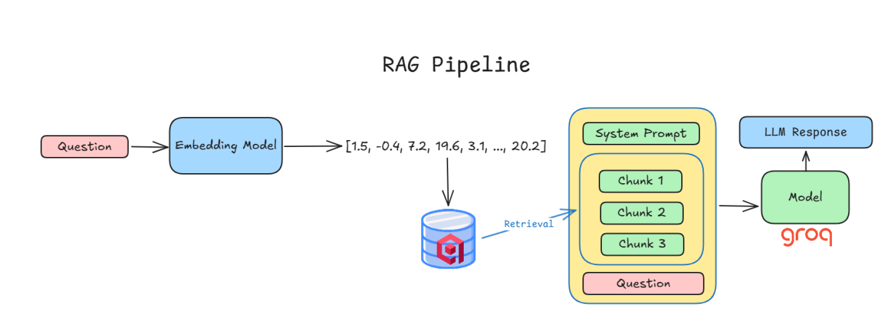
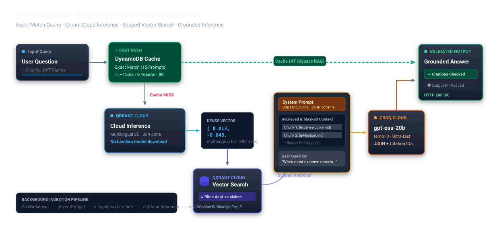

# KnowledgeLLM

> **Enterprise-grade, permission-aware RAG knowledge assistant with sub-20 ms answer caching, zero-trust department isolation, and grounded citation verification.**

Built with **React / TypeScript / Vite** · **AWS Lambda (Python 3.12)** · **Amazon Cognito** · **Amazon DynamoDB** · **AWS Bedrock (Cohere Multilingual v3)** · **Qdrant Cloud** · **Groq Cloud LLM** · fully provisioned with **Terraform**.



```
╔══════════════════════════════════════════════════════════════════════════════════════════════════════════╗
║                                          RAG Pipeline                                                   ║
╚══════════════════════════════════════════════════════════════════════════════════════════════════════════╝

  ┌────────────┐     ┌────────────────────────┐                          ┌────────────────────────────────┐     ┌───────────────┐
  │  Question  │────►│    Embedding Model     │──[1.5, -0.4, 7.2, ...]──►│                                │     │  LLM Response │
  └────────────┘     │  AWS Bedrock Cohere v3 │                          │  ┌──────────────────────────┐  │     └───────┬───────┘
                     │  1 024-dim · ap-se-1   │                          │  │      System Prompt       │  │             ▲
                     └────────────────────────┘                          │  ├──────────────────────────┤  │     ┌───────┴───────┐
                                    │                                    │  │ ┌──────────────────────┐ │  │────►│     Model     │
                                    │ Dense vector                       │  │ │       Chunk 1        │ │  │     │  Groq Cloud   │
                                    ▼                                    │  │ ├──────────────────────┤ │  │     │  gpt-oss-20b  │
                     ┌──────────────────────────┐                        │  │ │       Chunk 2        │ │  │     └───────────────┘
                     │      Qdrant Cloud        │  ── Retrieval ──────►  │  │ ├──────────────────────┤ │  │
                     │   Department filter      │  Top-K scoped chunks   │  │ │       Chunk 3        │ │  │
                     └──────────────────────────┘                        │  │ └──────────────────────┘ │  │
                                                                         │  └──────────────────────────┘  │
                                                                         │  ┌──────────────────────────┐  │
                                                                         │  │        Question          │  │
                                                                         │  └──────────────────────────┘  │
                                                                         └────────────────────────────────┘
```

---

## ⚡ Key Engineering Highlights

| # | Highlight | Detail |
|---|-----------|--------|
| 1 | **Sub-20 ms Cached Inferences** | Exact-match DynamoDB Cache-Aside for hot prompts — **99 % latency reduction** (~15 ms vs ~1.8 s), zero repeated LLM token costs |
| 2 | **Cold-Start Elimination (15 s → <200 ms)** | Migrated to **AWS Bedrock Cohere Multilingual v3 (1 024-dim)** in `ap-southeast-1`, eliminating CPU-bound container cold starts |
| 3 | **Zero-Trust RBAC** | Cognito JWT groups (`finance` / `operations` / `people`) enforced at both Qdrant vector retrieval **and** citation validation stages |
| 4 | **Zero Hallucination Guardrails** | `temperature=0`, rigid JSON output schema, backend validates every cited document ID against permitted excerpt context |
| 5 | **Event-Driven Ingestion** | S3 upload → EventBridge prefix-filtered rule → Ingestion Lambda → Qdrant upsert + immutable **S3 completion manifest** |

---

## 🏗️ System Architecture & Tech Stack

KnowledgeLLM ships two architectural designs: the **Active Hybrid Demo** (cost-conscious, sub-20 ms cache, fast iteration) and the **All-AWS Enterprise Reference** (fully managed AWS-native services).

### 1 · Active Hybrid Demo (Deployed Stack)



#### System Architecture Overview

```
╔══════════════════════════════════════════════════════════════════════════════════════════════════╗
║               System Architecture & Tech Stack  ·  Cost-conscious demo                          ║
╚══════════════════════════════════════════════════════════════════════════════════════════════════╝

  ── AUTH ─────────────────────────────────────────────────────────────────────────────────────────

  ┌───────────────┐   ◄──►   ┌──────────────────────────┐   ◄──►   ┌───────────────────────────┐
  │  React / Vite │          │  Cognito  CUSTOM_AUTH     │          │  Demo challenge Lambda    │
  └───────┬───────┘          └──────────────────────────┘          └───────────────────────────┘
          │
          │  Access token ──► API Gateway ──► Python Lambda
          │                                          │
  ── RAG QUERY ─────────────────────────────────────┼──────────────────────────────────────────────
          │                                          ▼
  ┌───────┴───────┐   ┌──────────────────┐   ┌──────────────────┐   ┌──────────────────────────┐
  │   Question    │──►│  FastEmbed       │──►│  Qdrant Cloud    │──►│ ┌────────────────────┐   │
  └───────────────┘   │  Lambda CPU      │   │  Department      │   │ │   System prompt    │   │
                      └──────────────────┘   │  filter          │   │ ├────────────────────┤   │
                                             └──────────────────┘   │ │  Permitted chunks  │──►│──► ┌────────┐   ┌──────────────┐
                                                      ▲  Retrieval  │ ├────────────────────┤   │    │  Groq  │──►│  Answer +    │
                                                      │             │ │     Question        │   │    └────────┘   │  sources     │
                                                      │             │ └────────────────────┘   │                 └──────────────┘
                                                      │             └──────────────────────────┘
  ── INGESTION ─────────────────────────────────────────────────────────────────────────────────────
                                                      │
  ┌───────────────┐   ┌──────────────────┐   ┌───────┴──────────┐
  │  Private S3   │──►│  EventBridge     │──►│  Ingestion Lambda│
  └───────────────┘   └──────────────────┘   │  + FastEmbed     │
                                             └──────────────────┘

  ── LEGEND ────────────────────────────────────────────────────────────────────────────────────────

  ┌──────────────────────────┐  ┌───────────────────────┐  ┌──────────────────────────┐  ┌────────────────────────┐
  │  Input / output          │  │  SSM:                 │  │  CloudWatch:             │  │  Cloudflare Pages:     │
  │  PII + citation checks   │  │  provider keys only   │  │  usage + guardrails      │  │  planned               │
  └──────────────────────────┘  └───────────────────────┘  └──────────────────────────┘  └────────────────────────┘
```

#### Request Lifecycle & Cache / RAG Flow

```
╔══════════════════════════════════════════════════════════════════════════════════════════════════╗
║                              KnowledgeLLM  ·  Request Lifecycle                                 ║
╚══════════════════════════════════════════════════════════════════════════════════════════════════╝

  ┌───────────────────┐  Cognito JWT  ┌──────────────────────────┐       ┌───────────────────────┐
  │   CLIENT (React)  │─────────────►│  API Gateway (JWT Auth)   │──────►│  Orchestrator Lambda  │
  └───────────────────┘              └──────────────────────────┘       └───────────┬───────────┘
                                                                                     │
                                      ┌──────────────────────────────────────────────┤
                                      │                                              │
                           ╔══════════▼══════════╗                      ╔════════════▼════════════╗
                           ║   Fast Path          ║                      ║   RAG Fallback           ║
                           ║   Cache HIT ✓        ║                      ║   Cache MISS ✗           ║
                           ╚══════════╤══════════╝                      ╚════════════╤════════════╝
                                      │                                              │
                           ┌──────────▼──────────┐                      ┌───────────▼─────────────┐
                           │  Amazon DynamoDB     │                      │  AWS Bedrock Cohere v3  │
                           │  Answer Cache        │                      │  Embed · 1 024-dim      │
                           ├─────────────────────┤                      │  ap-southeast-1         │
                           │  SHA-256 key lookup  │                      └───────────┬─────────────┘
                           │  ~15 ms · 0 tokens   │                                  │  Dense vector
                           │  24 h TTL · $0 cost  │                      ┌───────────▼─────────────┐
                           └──────────┬──────────┘                       │  Qdrant Vector DB        │
                                      │                                  │  Dept payload filter     │
                                      │                                  │  Top-5 scoped chunks     │
                                      │                                  └───────────┬─────────────┘
                                      │                                              │  Ranked excerpts
                                      │                                  ┌───────────▼─────────────┐
                                      │                                  │  Groq Cloud LLM          │
                                      │                                  │  gpt-oss-20b · temp=0    │
                                      │                                  │  Rigid JSON schema       │
                                      │                                  └───────────┬─────────────┘
                                      │                                              │  Answer + Citations
                                      └──────────────────────┬───────────────────────┘
                                                             │
                                              ┌──────────────▼──────────────┐
                                              │    Citation Guard            │
                                              │  Validate cited doc IDs      │
                                              │  against permitted excerpts  │
                                              └──────────────┬──────────────┘
                                                             │
                                              ┌──────────────▼──────────────┐
                                              │    200 OK · Grounded JSON   │
                                              │    answer  +  citations      │
                                              └─────────────────────────────┘
```

---

### 2 · All-AWS Managed Enterprise Reference

For enterprise environments requiring centralised compliance, sovereign data boundaries, and pure AWS-native operations:


```
  ┌────────────────┐    ┌─────────────────────┐    ┌──────────────────────────────────────┐
  │  Route 53 DNS  │───►│  Amplify Hosting     │───►│  Amazon Cognito  (SSO / RBAC)        │
  └────────────────┘    └─────────────────────┘    └──────────────────────────────────────┘
                                                                     │
                         ┌───────────────────────────────────────────▼──────────────────────────────────┐
                         │                     Amazon Bedrock Knowledge Bases                            │
                         │                                                                               │
                         │  ┌─────────────────────────────┐    ┌────────────────────────────────────┐  │
                         │  │  Titan Embeddings V2         │    │  OpenSearch Serverless (AOSS)       │  │
                         │  │  Managed vector generation   │    │  Scalable vector + keyword index    │  │
                         │  └──────────────┬──────────────┘    └──────────────────┬─────────────────┘  │
                         │                 └────────────────────────┬─────────────┘                     │
                         │                                          │  Retrieval                         │
                         │                         ┌───────────────▼───────────────┐                   │
                         │                         │  Nova Pro Inference            │                   │
                         │                         │  Bedrock Guardrails            │                   │
                         │                         │  PII masking · content filter  │                   │
                         │                         └───────────────┬───────────────┘                   │
                         └─────────────────────────────────────────┼───────────────────────────────────┘
                                                                    │
                         ┌──────────────────────────────────────────▼──────────────────────────────────┐
                         │  Step Functions — Ingestion Orchestration                                     │
                         │  S3 upload → EventBridge → Embedding → AOSS upsert → Completion manifest     │
                         └─────────────────────────────────────────────────────────────────────────────┘
```

---

## 🍱 Architecture Bento Box

| Layer | Component | Tech Stack | Role & Key Metrics |
|---|---|---|---|
| **01 · Identity** | Custom Demo Auth | **Amazon Cognito User Pool** | Passwordless 1-click persona switching (`finance`, `operations`, `people`) |
| **02 · Gateway** | HTTP API Gateway | **API Gateway v2** | Server-side JWT signature & claims verification, low-latency routing |
| **03 · Fast Path** | Answer Cache | **Amazon DynamoDB** | **~15 ms latency**, 0 Groq tokens, 24 h TTL for 15 hot demo questions |
| **04 · Embeddings** | Managed Embeddings | **AWS Bedrock Cohere v3** | **1 024-dim**, Singapore local (`ap-southeast-1`), eliminates 15 s cold starts |
| **05 · Vector DB** | Isolated Retrieval | **Qdrant Cloud** | Metadata-filtered vector search strictly bounded by authorised department |
| **06 · Inference** | Grounded LLM | **Groq Cloud (`gpt-oss-20b`)** | Temperature=0, rigid JSON output schema, mandatory citation enforcement |
| **07 · Ingestion** | Event-Driven Pipeline | **Amazon S3 + EventBridge** | Prefix-filtered triggers (`finance/`, etc.) with immutable completion manifests |
| **08 · IaC** | Cloud Automation | **Terraform & AWS SAM** | Multi-resource orchestration with S3 remote state and automated packaging |

---

## 🔐 Security & Multi-Tenancy

### Server-Enforced RBAC

```
  Cognito JWT
      │
      ▼
  ┌────────────────────────────────────────────────────────────┐
  │  Orchestrator Lambda                                        │
  │                                                            │
  │  1. Verify JWT signature (API Gateway — mandatory)         │
  │  2. Extract group claims  →  dept ∈ {finance, ops, people} │
  │  3. Pass dept to all downstream calls                      │
  └────────────────────────┬───────────────────────────────────┘
                           │
           ┌───────────────┼───────────────┐
           ▼               ▼               ▼
      Qdrant filter    Citation guard   PII guardrail
      (retrieval)      (validation)     (input+output)
```

```python
# Qdrant retrieval — strictly bounded by authorised department claims
models.Filter(
    must=[models.FieldCondition(key="department", match=models.MatchValue(value=dept))]
)
```

### Anti-Hallucination Citation Verification

The LLM is constrained by system prompts to answer strictly from supplied context excerpts. The backend parses returned citation IDs and checks them against permitted S3 document IDs — if citations are missing, mismatched, or out-of-scope the request **fails closed**.

### Defense-in-Depth PII Guardrails

Regex-based guardrails sanitise user input questions **and** model output answers for sensitive personal data (email, phone, SSN).

---

## 🚀 Quickstart & Local Development

### Prerequisites

- Node.js 20+ / npm
- Python 3.12
- AWS CLI configured with active credentials

### 1 · Web App

```sh
cd web
npm install
npm run dev      # Local Vite dev server → http://localhost:5173
npm test         # Run 45 Vitest unit & integration tests
npm run build    # Type-checked production bundle
```

### 2 · Backend API

```sh
cd api
python3.12 -m venv .venv
source .venv/bin/activate
pip install -e '.[dev]'
pytest           # Run backend test suite
```

### 3 · Deploy Infrastructure (Terraform)

```sh
# 1. Package Lambda artifacts (Linux x86_64 compatible)
bash scripts/package-lambdas.sh

# 2. Deploy AWS Infrastructure
cd infra/terraform
cp terraform.tfvars.example terraform.tfvars
terraform init
terraform apply
```

---

## 📊 Telemetry & CloudWatch Observability

Chat telemetry is logged as structured JSON to `/aws/lambda/knowledgellm-demo-knowledge`:

| Signal | Fields |
|--------|--------|
| **Latency & Tokens** | Request duration (ms), input / output token counts, estimated inference cost |
| **Guardrail Outcomes** | `pass` · `question_pii_blocked` · `source_pii_redacted` |
| **Cache Metrics** | Real-time DynamoDB hit / miss logging for performance verification |

---

## 📄 License

Fictional educational prototype created for portfolio and technical demonstration purposes.
